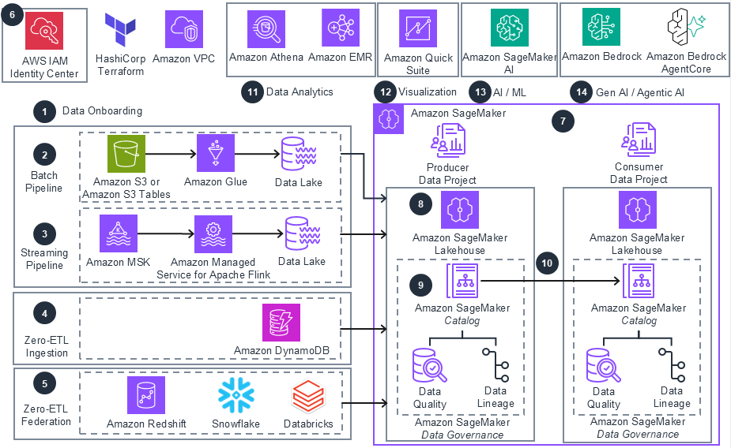

# **DAIVI** : _A Reference Solution with Terraform modules to accelerate development of Data, Analytics, AI and Visualization applications on AWS_

## Table of Contents

- [About DAIVI](#about-daivi-on-aws)
  - [Solution Architecture](#solution-architecture)
  - [Solution Capabilities](#solution-capabilities)
- [Data Lakes](#data-lakes)
- [Data Pipelines](#data-pipelines)
- [SageMaker Integration](#sagemaker-integration)
- [Agentic AI with Amazon Bedrock AgentCore](#agentic-ai-with-amazon-bedrock-agentcore)
- [Management Data Lake for Cost Analytics](#management-data-lake-for-cost-analytics)
- [Trading Data Lake](#trading-data-lake)
- [Deploying DAIVI](./docs/main/solutions-deployment.md)
- [Exploring DAIVI](./docs/demo/exploring-daivi.md)
- [Security Recommendations](./docs/main/security-recommendations.md)
- [Contributors](#contributors)

## About DAIVI on AWS

DAIVI is a reference architecture that illustrates how to rapidly deploy data, analytics, AI, and visualization solutions on AWS, using Amazon SageMaker, Amazon Quick Suite, and Amazon Bedrock AgentCore. The solution provides Infrastructure-as-Code (IaC) building blocks using Terraform to simplify the process of building enterprise data platforms on AWS. The goal is to provide engineers with sample Terraform modules that they can use as a starting point for their own implementations. The solution is being developed working backward from customer priorities.

### Solution Architecture

The architecture spans 14 capability areas, from data onboarding and identity management through to visualization and agentic AI:



### Solution Capabilities

| # | Capability | Description | AWS Services |
|---|------------|-------------|--------------|
| 1 | Data Onboarding | IaC modules to provision batch pipelines, streaming pipelines, zero-ETL ingestion and federated catalogs for external data sources | S3, Glue |
| 2 | Batch Pipelines | Batch data pipelines using AWS Glue to ingest structured data from S3 into Hive or Iceberg data lakes on S3 buckets or S3 Table buckets | AWS Glue, Amazon EMR |
| 3 | Streaming Pipelines | Streaming data pipelines using Apache Flink or Glue Streaming to ingest messages from MSK topics into data lakes, with support for streaming analytics | Amazon MSK, Apache Flink |
| 4 | Zero-ETL Ingestion | Direct data movement between source and target systems without building ETL pipelines | Amazon DynamoDB |
| 5 | Zero-ETL Federation | Direct querying of data across external sources without data movement or replication | Amazon Redshift, Snowflake, Databricks |
| 6 | Identity Center | Provision IAM Identity Center instances at organization or account level, create users and groups, and grant permissions needed for SageMaker domains and projects | IAM Identity Center |
| 7 | SageMaker Unified Studio | Provision SageMaker domains and projects, add members, configure lakehouse and compute, with IAM Identity Center integration for domain and project roles | Amazon SageMaker |
| 8 | Lakehouse | Federate data lakes into SageMaker Lakehouse using Lake Formation or zero-ETL integrations, providing a unified view across all data sources | Lake Formation, SageMaker Lakehouse |
| 9 | Data Governance | Create curated data assets, visualize data quality and data lineage, enforce governance policies for data access and alignment with business requirements | SageMaker Catalog, Lake Formation |
| 10 | Data Collaboration | Produce data assets from the producer project, subscribe and consume them from the consumer project | SageMaker |
| 11 | Data Analytics | Query data from data lakes using Athena, implement deep analytics using EMR | Amazon Athena, Amazon EMR |
| 12 | Visualization | AI-powered dashboards and reports using data in Lakehouse, with built-in agents for conversational data exploration | Amazon Quick Suite |
| 13 | AI / ML | Develop machine learning and AI applications | Amazon SageMaker AI |
| 14 | Gen AI / Agentic AI | Develop GenAI and Agentic AI applications using Bedrock foundation models, Knowledge Bases, Guardrails and AgentCore | Amazon Bedrock, AgentCore, Strands Agents |

## Data Lakes

The solution supports three data lake patterns:

| Pattern | Format | Storage | Use Case |
|---------|--------|---------|----------|
| Hive tables | Parquet | Standard S3 | Legacy compatibility, simple reads |
| Iceberg tables | Parquet with Iceberg metadata | Standard S3 | ACID transactions, schema evolution, time travel |
| Iceberg on S3 Tables | Parquet with Iceberg metadata | S3 Table buckets | Managed table storage with automatic compaction |

## Data Pipelines

The solution supports batch, streaming and zero-ETL data pipeline patterns:

- **Batch pipelines** using AWS Glue to load data from S3 into data lakes
- **Streaming pipelines** using Amazon MSK and Apache Flink for real-time data ingestion
- **Zero-ETL ingestion** from Amazon DynamoDB
- **Zero-ETL federation** with Amazon Redshift, Snowflake and Databricks

## SageMaker Integration

- **Domains and Projects** Provision SageMaker domains with IAM Identity Center integration, create producer and consumer projects with appropriate roles
- **Lakehouse** Load data lakes into SageMaker Lakehouse for unified access
- **Catalog** Standard and custom assets, data sources from data lakes, data quality rules, standard and custom lineage
- **Data Mesh** Producer and consumer governance model with Lake Formation permissions
- **QuickSight** Visualization dashboards connected to data lake sources via Athena

Note: Additional reading about DAIVI architecture and design principles [here](./docs/main/design-principles.md).

## Agentic AI with Amazon Bedrock AgentCore

The solution includes a financial analyst agent module that lets users ask questions in natural language. The agent determines which databases to query, writes the SQL, executes it through Athena and returns results. It can also search the web for additional context.

```
User: "Which stocks were traded the most?"
  → Agent calls get-databases and get-database-tables to learn the schema
  → Agent writes SQL: SELECT security_id, SUM(quantity) ... GROUP BY security_id
  → Agent calls execute-query via Athena
  → Agent returns formatted results
```

The module is split into three independent Terraform roots:

- **Backend** Cognito auth, IAM roles, 4 Lambda functions (get-databases, get-database-tables, execute-query, web-search), AgentCore Memory, read-only Lake Formation grants on the equity trade and equity price data lake tables, SSM parameter interface
- **Gateway** Amazon Bedrock AgentCore MCP gateway with CUSTOM_JWT auth, 4 tool targets wired to the Lambda functions
- **Demo** Chat UI with API Gateway and Lambda running a Strands agent on Amazon Nova 2 Lite (default) or Claude Haiku 4.5

The gateway exposes tools over the Model Context Protocol (MCP), so any MCP-compatible client or framework can connect.

For more details see the [AgentCore module README](./iac/roots/agentcore/README.md).

## Management Data Lake for Cost Analytics

Working backward from the needs of a customer, the solution implements a management data lake for cost analytics to demonstrate how to create Hive and Iceberg data lakes on S3 buckets and S3 Table buckets, and how to implement batch data pipelines using Glue.

### AWS Cost and Usage Data Lake

The solution uses a Glue batch data pipeline to load AWS Cost and Usage report to Hive and Iceberg data lakes.


### AWS S3 Inventory Data Lake

The solution uses a Glue batch data pipeline to load AWS S3 Inventory report to Hive and Iceberg data lakes.


### Splunk Data Lake

The solution uses a Glue batch data pipeline to load operational data from a Splunk instance into Iceberg data lakes.


## Trading Data Lake


## Next Steps

- [Deploying DAIVI](./docs/main/solutions-deployment.md)
- [Exploring DAIVI](./docs/demo/exploring-daivi.md)
- [Security Recommendations](./docs/main/security-recommendations.md)
- Additional Resources:
  - [About Amazon SageMaker Unified Studio](./docs/amazon-sagemaker-unified-studio.md)
  - [About Amazon SageMaker Unified Studio Lakehouse](./docs/amazon-sagemaker-unified-studio-lakehouse.md)

## Contributors

- [Bikash Behera](https://www.linkedin.com/in/bikash-behera/)
- [Max Tybar](https://www.linkedin.com/in/maxtybar/)
- [Rams Sundaram](https://www.linkedin.com/in/ramasubramanian-sundaram-2616312/)
- [Yong Zhang](https://www.linkedin.com/in/zhangyong/)
- [Noah Coffin](https://www.linkedin.com/in/noah-coffin/)
- [Vivian Bui](https://www.linkedin.com/in/vivian-bui-413a561b6/)
- [Lionel Pulickal](https://www.linkedin.com/in/pjlionel/)
- [Marine Haddad](https://www.linkedin.com/in/marine-haddad-38a542b5/)
- [Kshitija Nandkishor Dound](https://www.linkedin.com/in/kshitijadound/)
- [Hardik Thakkar](https://www.linkedin.com/in/hardikvthakkar/)
- [Hemal Gadhiya](https://www.linkedin.com/in/hemal-gadhiya/)
- [Shivanjani Pathipaka](https://www.linkedin.com/in/shivanjani-pathipaka/)
- [Alseny Diallo](https://www.linkedin.com/in/dialloalseny/)
- [Darasimi Oluwaniyi](https://www.linkedin.com/in/darasimi-oluwaniyi/)
- [Donatas Kuchalskis](https://www.linkedin.com/in/donatas-kuchalskis-5b0b20170/)
