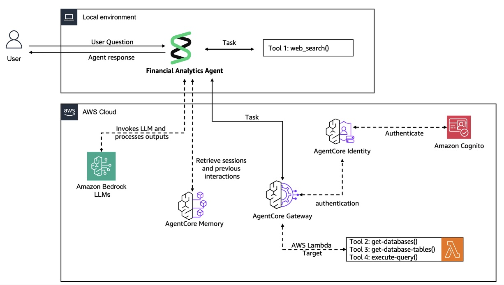

# AgentCore Module

Three independent Terraform roots, `backend/`, `gateway/`, and `demo/`, with separate state files.
Deploy in order: backend, gateway, demo.

## Architecture



## Features

### Stateful Sessions & Agent Memory

The agent uses **Amazon Bedrock AgentCore Memory**, a fully managed service that persists conversations
and automatically extracts insights. Each conversation event is stored under an `actorId` derived from
the user's email in the JWT, and a session ID, enabling per-user memory isolation. AgentCore Memory
allows only letters, digits, `-`, `_` and `/` in actor IDs, so `@` becomes `_at_` and `.` becomes `_`.
The service handles retrieval, summarization, and preference extraction without custom application code.

### Memory Strategies

The implementation uses **both short-term (STM) and long-term (LTM) memory**:

- **Short-term memory:** Within a session, the `AgentCoreMemorySessionManager` automatically loads
  prior conversation turns (matched by `session_id`) so the agent maintains awareness of what was
  just discussed.
- **Long-term memory:** Across sessions, the three LTM strategies below extract preferences, facts,
  and session summaries so the agent recalls context from prior conversations with the same user
  (matched by `actor_id`).

The AgentCore Memory resource is configured with three built-in LTM strategies that automatically
process conversation events:

| Strategy | Name | Namespace | What It Does |
|----------|------|-----------|--------------|
| `summaryMemoryStrategy` | SessionSummarizer | `/summaries/{actorId}/{sessionId}/` | Auto-generates conversation summaries per session. Provides condensed context for long conversations. |
| `userPreferenceMemoryStrategy` | PreferenceLearner | `/preferences/{actorId}/` | Extracts user preferences from conversations (e.g., preferred tables, reporting style). Replaces manual context input. |
| `semanticMemoryStrategy` | FactExtractor | `/facts/{actorId}/` | Extracts factual knowledge and entities discussed across sessions. Enables cross-session recall. |

**Configuration:** The memory resource is provisioned via Terraform (`aws_bedrockagentcore_memory`)
with `event_expiry_duration = 90` days. Each strategy is a separate
`aws_bedrockagentcore_memory_strategy` resource using the `namespaces` attribute with `{actorId}`
(derived from the user's email) and `{sessionId}` to partition data per user and session. The service
automatically processes conversation events and extracts insights without application code.

The three strategy resources are deliberately chained so they apply one at a time. See "Memory
strategies are applied one at a time" under [Things to Know](#things-to-know) for why, and for
the reasoning behind the `destroy_duration` spacing.

### How Memory Works at Runtime

The demo Lambda uses the Strands `AgentCoreMemorySessionManager` from the `bedrock-agentcore` SDK.
A session manager is created for each chat request and passed to the Strands agent, which then
loads, retrieves, and saves memory without further application code:

```
User sends message (session_id, or empty for a new conversation)
       │
       ▼
1. AgentCoreMemorySessionManager(memory_id, session_id, actor_id, retrieval_config)
   → Loads the session's prior turns (short-term memory)
   → Retrieves long-term memory records for the prompt from three namespaces:
       • /preferences/{actorId}/          top 5, relevance ≥ 0.5
       • /facts/{actorId}/                top 5, relevance ≥ 0.3
       • /summaries/{actorId}/{sessionId}/ top 3, relevance ≥ 0.5
       │
       ▼
2. Agent processes the prompt with that context, calls tools, returns a response
       │
       ▼
3. The session manager saves each new message as an AgentCore Memory event
   → The strategies process the events asynchronously:
       • SessionSummarizer: generates/updates session summary
       • PreferenceLearner: extracts preferences mentioned in conversation
       • FactExtractor: pulls out factual knowledge for cross-session recall
```

The session sidebar is loaded server-side via the AgentCore Memory `list_sessions` API. There is
no `localStorage` or DynamoDB dependency: AgentCore Memory is the single source of truth for both
the session index and the conversation history. This means session history persists across devices
and survives browser cache clears.

The Lambda exposes two non-chat actions for the UI:

- `list_sessions` — calls `bedrock-agentcore.list_sessions(memoryId, actorId)` and returns past
  sessions for the signed-in user.
- `load_session` — calls `bedrock-agentcore.list_events(memoryId, actorId, sessionId,
  includePayloads=True)` and returns the user/assistant turns for display.

### Model Selection

The default model is **Amazon Nova 2 Lite** (`us.amazon.nova-2-lite-v1:0`), a fast and cost-effective
multimodal model. Users can switch to **Claude Haiku 4.5** (`us.anthropic.claude-haiku-4-5-20251001-v1:0`)
via the UI model picker. The selected model key (`nova` or `haiku`) is sent with each request and the
agent is created with that model per invocation. A request without a model key uses Nova 2 Lite.

### Code Structure (Demo Lambda)

The demo Lambda is split into two modules for separation of concerns:

| File | Responsibility |
|------|---------------|
| `chat_src/chat.py` | Handler, MCP client setup, action routing, agent creation with AgentCore Memory |
| `chat_src/memory.py` | Sidebar helpers: list a user's sessions and load a session's messages |

`_handle_post` routes on the request's `action` field: `list_sessions`, `load_session`, or chat
(the default).

## Architectural Decisions

### 1. AgentCore Memory for Session Persistence

Agent memory uses the managed **Amazon Bedrock AgentCore Memory** service.

**Why:** AgentCore Memory provides automatic preference extraction, semantic fact recall, and session
summarization without application code. Conversation events are processed through configured strategies
(summaries, preferences, facts), eliminating the need for custom CRUD logic, manual history injection
into prompts, or user-facing preference input panels. Sessions persist server-side and are accessible
across devices without browser-local storage.

### 2. Lambdas run outside VPC (default Lambda networking)

All four backend Lambdas (`get-databases`, `get-database-tables`, `execute-query`, `web-search`)
run in AWS default Lambda networking, no VPC attachment.

**Why:** These Lambdas only call public AWS APIs (Glue, Athena, S3) and external APIs (DuckDuckGo).
They don't access any VPC-private resources (no RDS, ElastiCache, or private ALBs). Running outside
the VPC eliminates cold start ENI creation delays (10-30s), removes the dependency on a NAT Gateway,
and reduces cost. Access control is enforced via IAM policies, not network-level security groups.

**Trade-off:** No VPC Flow Logs for Lambda traffic and no network-level egress controls. CloudTrail
still captures all AWS API calls. If VPC-private resources are added later, re-add `vpc_config` to
the Lambdas that need them and ensure a NAT Gateway or VPC endpoints exist.

### 3. Lambda layer builds target Linux x86_64

Both Lambda layers (`ddgs` and `chat`) are built with
`--platform manylinux2014_x86_64 --python-version 3.13 --only-binary=:all:` to ensure native
binaries (e.g., `lxml` in ddgs) are compiled for Amazon Linux.

**Why:** Without platform targeting, `pip` installs macOS-native wheels on Mac, which fail at
runtime on Lambda's Amazon Linux with errors like `cannot import name 'etree' from 'lxml'`.

### 4. API Gateway HTTP API with Cognito JWT authorizer

The demo UI is served via a public API Gateway HTTP API. The `GET /` route (login page) has no
authentication. The `POST /chat` route requires a valid Cognito JWT token.

**Why:** Prevents unauthorized access to the agent, which would consume Bedrock tokens and query
the data lake tables. Users must sign in via the Cognito Hosted UI before they can chat. Self-registration
is disabled, only admin-created users (provisioned via Terraform) can log in.

**Trade-off:** First-time users must change their temporary password via the Cognito Hosted UI
before accessing the chat. This is a one-time step per user.

### 5. MCP gateway with Cognito CUSTOM_JWT auth

The Bedrock AgentCore gateway uses `CUSTOM_JWT` authorizer type with Cognito as the OIDC provider,
not `AWS_IAM`.

**Why:** The `AWS_IAM` authorizer type has a known provider bug with the Bedrock AgentCore gateway
at the time of implementation. `CUSTOM_JWT` with Cognito `client_credentials` flow works reliably
and provides machine-to-machine authentication without user interaction.

### 6. SSM parameters as the interface contract

The backend publishes 11 SSM SecureString parameters under `/{APP}/{ENV}/agentcore/*`, and the
gateway publishes one more, `gateway-url`, as a plain `String`. The gateway and demo modules read
them via `data.aws_ssm_parameter` blocks, and the demo Lambda reads some of them at runtime,
keeping the modules independently deployable.

**Why:** Decouples the three modules so they can be developed, deployed, and destroyed independently.
No cross-module `terraform_remote_state` references. SSM also provides encryption at rest via KMS
and audit logging via CloudTrail.

### 7. Gateway targets use unqualified Lambda ARNs

Gateway targets point to Lambda function ARNs without version qualifiers (resolves to `$LATEST`).

**Why:** Simplifies deployments, updating Lambda code takes effect immediately without needing to
update the gateway target. For production, consider using qualified ARNs with aliases for safe
rollbacks.

## Backend, Resources Created

- KMS key: `{APP}-{ENV}-lambda-key`
- IAM roles: `agent-core-role` (gateway assumes) + `agentcore-lambda-role` (shared Lambda execution)
- Cognito: user pool (self-registration disabled, password history), domain, resource server (`read` scope), app client (`client_credentials`), preconfigured demo user with a generated temporary password
- 4 Lambda functions: `get-databases`, `get-database-tables`, `execute-query`, `web-search`
- AgentCore Memory: `{APP}_{ENV}_agentcore_memory` (3 strategies: summary, user preference, semantic)
- CloudWatch log delivery for AgentCore Memory APPLICATION_LOGS:
  - Log group: `/aws/vendedlogs/bedrock-agentcore/memory/<memory-id>` (30-day retention)
  - Delivery source, destination, and binding via `aws_cloudwatch_log_delivery_*`
- S3 bucket for Lambda deployment packages
- Read-only Lake Formation grants for the Lambda role on specific data-lake tables, looked up
  in `lakeformation.tf` (see note 3). This module creates no Glue database or tables of its own.
- 11 SSM parameters (see below)

### SSM Parameters

| Path | Value |
|------|-------|
| `/{APP}/{ENV}/agentcore/cognito-user-pool-id` | Cognito User Pool ID |
| `/{APP}/{ENV}/agentcore/cognito-app-client-id` | Cognito App Client ID |
| `/{APP}/{ENV}/agentcore/cognito-endpoint` | Cognito OAuth domain URL |
| `/{APP}/{ENV}/agentcore/cognito-domain` | Cognito domain prefix |
| `/{APP}/{ENV}/agentcore/lambda-get-databases-arn` | Lambda ARN |
| `/{APP}/{ENV}/agentcore/lambda-get-database-tables-arn` | Lambda ARN |
| `/{APP}/{ENV}/agentcore/lambda-execute-query-arn` | Lambda ARN |
| `/{APP}/{ENV}/agentcore/lambda-web-search-arn` | Lambda ARN |
| `/{APP}/{ENV}/agentcore/agent-core-role-arn` | IAM role ARN for gateway |
| `/{APP}/{ENV}/agentcore/memory-id` | AgentCore Memory resource ID |
| `/{APP}/{ENV}/agentcore/demo-user-temp-password` | Randomly generated temporary password for the demo user |

All are `SecureString` encrypted with `{APP}-{ENV}-systems-manager-secret-key`.

### Demo User

A preconfigured user is created for the demo:

| Field | Value |
|-------|-------|
| Username | `daivi-agent@example.com` |
| Temporary password | Generated at deploy time, stored in SSM |

Fetch the demo URL and the temporary password with:

```bash
make get-agentcore-demo-url
make get-agentcore-demo-password
```

or directly:

```bash
aws ssm get-parameter \
  --name "/{APP}/{ENV}/agentcore/demo-user-temp-password" \
  --with-decryption \
  --query Parameter.Value \
  --output text
```

The temporary password is only valid until the first sign-in; Cognito then prompts the user to set a new password. Unused temporary passwords also expire after the user pool's temporary password validity (7 days by default).

> **⚠️ Disclaimer:** In a production environment, credentials should be shared securely (e.g., via a secrets manager or secure onboarding flow). For the purposes of this demo, a single user is created with a randomly generated temporary password, and a password change is required on first sign-in. Do not deploy this demo into an account that holds production data.

## Gateway, Resources Created

- Bedrock AgentCore MCP gateway with CUSTOM_JWT auth via Cognito
- 4 gateway targets: `get-databases`, `get-database-tables`, `execute-query`, `web-search`
- SSM parameter: `/{APP}/{ENV}/agentcore/gateway-url`

## Demo, Resources Created

- S3 bucket for static site assets
- Cognito app client (`authorization_code` flow, callback URLs set to API Gateway)
- JWT authorizer on `POST /chat` route
- Lambda function with Strands agent + MCP client (split into `chat.py` + `memory.py`)
- Lambda layer (`strands-agents[mcp]`, `bedrock-agentcore[strands-agents]`, `requests`)
- API Gateway HTTP API with two routes (`GET /` unauthenticated, `POST /chat` JWT-protected)
- AgentCore Memory access for conversation persistence and context retrieval

## Prerequisites

Deploy these before the backend. The first three are looked up at plan time, so
`terraform plan` fails if they are missing.

| Requirement | How to deploy | Why the backend needs it |
|---|---|---|
| Equity Price S3-Glue-S3 data lake | `make deploy-price-glue-all` | `lakeformation.tf` looks up the `equity_price_s3_glue_s3_iceberg` table |
| Equity Trade S3-Glue-S3 data lake | `make deploy-trade-glue-all` | `lakeformation.tf` looks up the `equity_trade_s3_glue_s3_iceberg` table |
| KMS keys | `make deploy-kms-keys` | The SSM parameters are encrypted with `{APP}-{ENV}-systems-manager-secret-key` |
| Athena | `make deploy-buckets` and `make deploy-athena` | `execute-query` runs in the `{APP}-{ENV}-workgroup` workgroup and writes results to `{account}-{APP}-{ENV}-athena-output`. These are referenced by name, so a missing workgroup fails queries at runtime rather than at plan time |
| Lake Formation admin | Add the deploying role to the Lake Formation data lake admins | The backend grants Lake Formation permissions on the data lake tables |
| Bedrock model access | Confirm the account can invoke Nova 2 Lite and Claude Haiku 4.5. Anthropic models require a one-time use case form per account | The demo Lambda invokes these models through their `us.` inference profiles |
| `pip3` | Installed locally | Builds the Lambda layers, see decision 3 |

The data lakes depend on their own prerequisites (Foundation, Glue Iceberg jar, Lake Formation,
Athena); see the [deployment guide](../../../docs/main/solutions-deployment.md). The make targets
above also run the Glue jobs that load data into the Iceberg tables. The lookups only need the
tables to exist, but the agent has nothing to query until the jobs have run.

## Deploy

```bash
# Deploys backend, gateway, then demo
make deploy-agentcore

# Demo URL, and the temporary password for the demo user daivi-agent@example.com
make get-agentcore-demo-url
make get-agentcore-demo-password

# Tears down demo, gateway, then backend
make destroy-agentcore
```

Each root can also be applied on its own, in order:

```bash
# 1. Backend (creates Lambdas, Cognito, SSM params)
cd iac/roots/agentcore/backend
terraform init
terraform apply

# 2. Gateway (reads backend SSM params, creates MCP gateway)
cd ../gateway
terraform init
terraform apply

# 3. Demo UI (reads backend and gateway SSM params, creates chat app)
cd ../demo
terraform init
terraform apply
```

The backend apply takes roughly 10 minutes, most of it spent creating the three AgentCore Memory
strategies sequentially (~2m30s each). Terraform will sit on
`aws_bedrockagentcore_memory_strategy... Still creating...` for minutes at a time. This is
expected, not a hang. A backend teardown takes longer still, 25 to 30 minutes, for the reasons
in note 5.

## Things to Know

1. **Provider v6 required**, all three roots use AWS provider `~> 6.0`, independent from the
   rest of the solution (which uses v5). The backend root additionally requires
   `hashicorp/time ~> 0.12`, used to sequence the memory strategies (see note 5), and
   `hashicorp/random ~> 3.6`, used to generate the demo user's temporary password.

2. **Lake Formation**, the deployer role must be a Lake Formation admin. Add your role to the
   LF data lake admins before first deploy.

3. **The agent queries the data lakes' own tables**, so deploy the data-lake modules before
   this one. `lakeformation.tf` looks up the tables the agent may read with
   `aws_glue_catalog_table` data sources, currently `equity_trade_s3_glue_s3_iceberg` and
   `equity_price_s3_glue_s3_iceberg`, and grants read-only access: `DESCRIBE` on each table's
   database, and `SELECT` and `DESCRIBE` on that table only. The lookups create nothing, and
   `terraform plan` fails with a clear error if a table does not exist yet. To expose another
   dataset, add a lookup and an entry in `local.agent_tables`.

   Reading the data lakes' own tables means the agent always sees the latest committed data,
   because those are the tables the loader jobs write into, and the schemas stay owned by the
   data lakes.

4. **Demo Lambda caching**, the MCP client, and the gateway access token it was created with,
   are cached across warm invocations. The agent itself is created per request.
   If you redeploy the gateway (new URL), update a demo Lambda env var to force a cold start:
   `aws lambda update-function-configuration --function-name {APP}-{ENV}-agentcore-demo-chat --environment '{"Variables":{"CACHE_BUST":"v2",...}}'`

5. **Memory strategies are applied one at a time, and this is deliberate.** Each
   `aws_bedrockagentcore_memory_strategy` is implemented as an `UpdateMemory` call against the
   same parent memory, and AgentCore Memory accepts only one mutation at a time. Concurrent
   calls are rejected with `Memory is in transitional state UPDATING`.

   `memory.tf` therefore chains the three strategies with `depends_on` and inserts `time_sleep`
   resources between them. Both parts are load-bearing:

   | Path | Provider behavior | What the chain provides |
   |------|-------------------|-------------------------|
   | Create | Waits until the strategy is `ACTIVE` (~2m30s each) | `depends_on` ordering only. No create-side delay is needed. |
   | Destroy | Also waits (2.5 to 5 min per delete) | `destroy_duration = "150s"` spacing between deletes, which Terraform runs in reverse order |

   The `depends_on` chain is required: without it the strategies are created concurrently and
   rejected. The `destroy_duration` spacing lets the memory settle between deletes, so a
   teardown never leaves a strategy in the service after it has been removed from state. It
   adds about 5 minutes to a teardown.

   Expect roughly 8 minutes to create all three strategies, and 25 to 30 minutes for a full
   backend teardown, most of it AgentCore deleting the memory resource itself. This requires
   the `hashicorp/time` provider, declared in `provider.tf`.

   These are service-side durations. Terraform reports elapsed wall-clock time, so on a laptop
   that sleeps mid-apply the counter can show far longer than the real provisioning time. Use
   `caffeinate -i` alongside long applies, and rely on service-side timestamps.

6. **Resource names are scoped by `APP` and `ENV`** so that multiple environments can coexist in
   one account. The data-lake databases the agent reads are an exception: the data-lake modules
   use fixed names such as `equity_trade_s3_glue_s3`, so two environments in one account share
   them.

7. **The demo root owns the human login Cognito client**, because its callback and logout URLs
   depend on the demo API Gateway stage URL. The backend root defines only the
   machine-to-machine client used by the MCP gateway.

8. **Lambda layer builds are keyed off requirements file hashes.** The ddgs layer reads
   `lambda-layers/ddgs-requirements.txt` and the chat layer reads
   `lambda-functions/requirements.txt`. A layer is rebuilt and republished only when its pinned
   requirements change, so applies stay idempotent and layer versions do not accumulate.
   `.gitignore` excludes built layer payloads but keeps `*-requirements.txt` files tracked,
   since the builds hash them.
